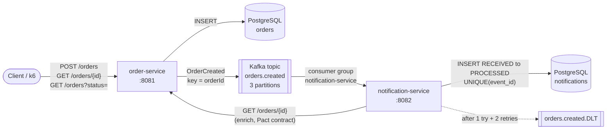

# event-driven-quality-suite

[](https://github.com/saransh62/event-driven-quality-suite/actions/workflows/ci.yml)


Two deliberately small Spring Boot microservices connected by Kafka, and a test suite around them
covering five layers: **integration tests with Testcontainers, consumer-driven contracts with Pact,
end-to-end event-flow tests, resilience tests with consumer-lag assertions, and k6 load tests**, all
running in GitHub Actions. The services are small on purpose. The tests are the product.

## Architecture



| Component | Responsibility |
|---|---|
| **order-service** | Validates and persists orders, then publishes `OrderCreated` (key = `orderId`, carries a unique `eventId`). |
| **notification-service** | Consumes `orders.created`, skips duplicate `eventId`s, enriches through `GET /orders/{id}`, and stores a `PROCESSED` notification. Failing records are retried twice and then sent to `orders.created.DLT`. |
| **Kafka** | `apache/kafka` in KRaft mode (no ZooKeeper). |
| **PostgreSQL** | One server with one database per service, migrated by Flyway. |

## What each test layer proves

| Layer | Where | Runs against | What it proves |
|---|---|---|---|
| **Integration: order-service** | `integration-tests/…/OrderServiceIntegrationTest` | Real Kafka + PostgreSQL (Testcontainers) | `POST /orders` persists the row **and** publishes **exactly one** event with the right key and payload. Invalid or malformed input returns a clear 400 body with nothing persisted or published. `GET` by id, 404, and status filter. |
| **Integration: notification-service** | `integration-tests/…/NotificationServiceIntegrationTest` | Real Kafka + PostgreSQL, WireMock in place of order-service | An event becomes a `PROCESSED` notification. A **duplicate event is ignored** (no second row, no second HTTP call). Malformed JSON, missing fields and enrichment failures are **retried and then dead-lettered** without leaving partial rows. A poison pill doesn't block the partition. |
| **Contract (Pact)** | `contract-tests/` | Pact mock server (consumer), then real order-service (provider) | notification-service's expectations for `GET /orders/{id}` (200 with provider state, and 404) are met by the real order-service. A breaking change fails the provider build ([example](#how-a-breaking-api-change-is-caught)). |
| **E2E event flow** | `e2e-tests/…/EventFlowE2ETest` | `docker compose` stack | 25 orders go through HTTP, Kafka, the consumer, HTTP enrichment and the DB. Each one is `PROCESSED` exactly once, and **consumer-group lag returns to 0** (AdminClient). |
| **Resilience** | `e2e-tests/…/ResilienceE2ETest` | `docker compose` stack | The test stops notification-service and creates 30 orders, and **lag is exactly 30**. After a restart the backlog is fully processed, **with no duplicates**, and lag returns to 0. |
| **Load** | `load-tests/` | `docker compose` stack | Ramping open-model load on `POST /orders` with thresholds **p95 < 300 ms** and **errors < 1%**, then reports consumer lag and **time to drain**. Writes a JSON summary. |

## Running each layer locally

Prerequisites: Java 17, Maven 3.9+, Docker (with `docker compose` or `docker-compose`), and k6.

```bash
# 1. Integration + contract tests (Testcontainers starts Kafka and PostgreSQL by itself)
mvn verify

#    only one layer:
mvn verify -pl integration-tests -am
mvn verify -pl contract-tests -am
```

```bash
# 2. Run the full system
mvn -q install -DskipTests
docker compose up -d --build --wait            # add --profile ui for Kafka UI on :8090
curl -s -XPOST localhost:8081/orders -H 'content-type: application/json' \
  -d '{"customerEmail":"ada@example.com","product":"Keyboard","quantity":1,"amount":49.90}'
curl -s "localhost:8082/notifications?orderId=<id from above>"
```

```bash
# 3. E2E event-flow + resilience tests (needs the stack from step 2)
mvn test -pl e2e-tests -Pe2e
```

```bash
# 4. Load test + drain measurement (needs the stack from step 2)
k6 run load-tests/orders-load.js                       # full profile, ~2.5 min, up to 100 req/s
k6 run -e PROFILE=smoke load-tests/orders-load.js      # CI profile, ~40 s, up to 20 req/s
load-tests/measure-drain.sh                            # lag right after the run and time to drain
# outputs: load-tests/results/k6-summary.json, load-tests/results/drain.json
```

```bash
docker compose down -v
```

<details>
<summary>Using Colima instead of Docker Desktop (macOS)</summary>

Testcontainers needs to be pointed at Colima's socket:

```bash
export DOCKER_HOST=unix://$HOME/.colima/default/docker.sock
export TESTCONTAINERS_DOCKER_SOCKET_OVERRIDE=/var/run/docker.sock
```
</details>

## How a breaking API change is caught

The pact records what notification-service reads from `GET /orders/{id}`. To demonstrate, rename
`customerEmail` to `email` in order-service's `OrderResponse`. Every order-service integration test still
passes, because they only test the provider. The provider verification fails:

```text
Verifying a pact between notification-service and order-service
  Given order 3f1c2b7e-8a4d-4e5f-9b6a-1c2d3e4f5a6b exists
  a request for an existing order
    returns a response which
      has status code 200 (OK)
      has a matching body (FAILED)

Failures:
1) Verifying a pact between notification-service and order-service - a request for an existing order has a matching body
    1.1) body: $ Actual map is missing the following keys: customerEmail
```

Run it yourself with `mvn verify -pl contract-tests -am` after making the rename. Adding a new field is fine,
because the consumer only pins the fields it uses. CI also regenerates the pact and fails if it differs from
the committed file, so the contract in git can't drift from the consumer code.

## Sample k6 results

Full `load` profile (`k6 run load-tests/orders-load.js`) on a MacBook (Apple Silicon), with the whole
stack in Colima (2 vCPU, 4 GB):

| Metric | Result | Threshold |
|---|---|---|
| Requests (`POST /orders`) | 9,387 in 150 s (avg 62.6 req/s, peak stage 100 req/s) | |
| Latency avg / median | 3.61 ms / 2.54 ms | |
| Latency p90 / **p95** | 5.63 ms / **7.15 ms** | p95 < 300 ms ✅ |
| Latency max | 245.81 ms | |
| **Error rate** | **0.00 %** | < 1 % ✅ |
| Checks (201 + id) | 100 % (18,774 / 18,774) | > 99 % ✅ |
| Dropped iterations | 3 (k6 briefly ran out of pre-allocated VUs) | |
| Consumer lag right after the run | 0 | |
| Time to drain | ≤ 1 s (`drain.json`) | |

The consumer kept up with 100 req/s, so lag stayed at 0. The local smoke profile (20 req/s peak) measured
p95 = 18.6 ms. CI uploads the summary JSON and `drain.json` as the `e2e-and-load-results` artifact
on every run.

## CI

`.github/workflows/ci.yml`

| Job | Steps |
|---|---|
| **Unit + integration + contract tests** | `mvn verify` (Testcontainers on `ubuntu-latest`), stale-pact check, upload surefire/failsafe reports |
| **E2E + resilience + k6 smoke** | build jars, `docker compose up --wait`, e2e + resilience tests, k6 smoke run with thresholds, drain measurement, upload the k6 summary and reports, `docker compose down` |

## Project layout

```text
order-service/          Spring Boot: REST, JPA, Flyway, Kafka producer
notification-service/   Spring Boot: Kafka consumer, idempotency, DLT, RestClient
integration-tests/      Testcontainers tests for both services
contract-tests/         Pact consumer + provider tests; pacts/ holds the contract
e2e-tests/              Black-box tests against docker compose (-Pe2e)
load-tests/             k6 script and drain-time script
docker/                 PostgreSQL init script (one DB per service)
```

Further reading: [DESIGN.md](DESIGN.md) explains the design choices. [LEARNING.md](LEARNING.md) has a code walkthrough and interview Q&A.

## Assumptions

- **Single integration-tests module:** both services' integration tests live in `integration-tests`
  (as in the spec's module list). To share one classpath, each service reads its config from a
  profile-specific file (`application-order.yml` / `application-notification.yml`) and has its own
  Flyway location. Each service's `jar` stays a plain library jar, and the runnable jar has the `exec` classifier.
- **Separate databases on one PostgreSQL server** (`orders`, `notifications`) satisfy
  "its own PostgreSQL schema or table".
- **Event payload:** JSON strings (`StringSerializer`) rather than a schema registry. Each event carries a
  unique `eventId`, and the consumer uses it as the idempotency key.
- **"Mark it PROCESSED":** the row is inserted as `RECEIVED` and moved to `PROCESSED` in the same
  transaction after enrichment. A failure rolls both back, so a retry starts clean.
- **Retries:** 1 attempt + 2 retries, 500 ms apart, for every failure type (the spec says "DLT after
  retries"). DESIGN.md notes that production would make deserialization errors non-retryable.
- **DLT:** the dead-letter topic is created by notification-service with the same partition count, and records go to the
  same partition number as the original.
- **No Pact broker:** the pact file is committed in `contract-tests/pacts/`, and a CI check fails if it's stale.
- **e2e-tests** are skipped by default and enabled with `-Pe2e`, because they need a running compose stack.
- **Notification lookup endpoint** (`GET /notifications?orderId=`): added only so black-box e2e tests can
  observe the outcome.
- **order-service publishes synchronously** inside its DB transaction. The outbox pattern is out of scope
  (see DESIGN.md §6).
- **Kafka UI** is optional (`docker compose --profile ui up`) so the default stack stays light.
